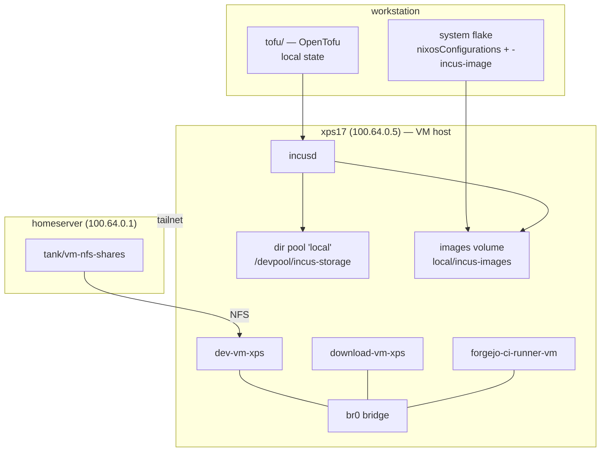

My `xps17` laptop is the VM host for my home fleet. It ran three QEMU/KVM guests
under libvirt, with their memory and vCPU counts hardcoded in Nix and a
hand-rolled `build-and-deploy-vm.sh` that did `disko` → `qemu-img` →
`virt-install`. It worked, but the resources weren't really declarative and the
provisioning script was imperative and fragile.

I wanted a modern VM manager plus a real declarative definition of the guests and
their resources, so I moved everything to [Incus](https://linuxcontainers.org/incus/)
managed by [OpenTofu](https://opentofu.org/). The NixOS guests stay NixOS and are
still updated in place with my `nup-fleet` script. The goal of the migration was
to preserve the installed state — a lift-and-shift, not a rebuild.

### Preparing the guests first

Before touching the hypervisor, I tightened up the shared guest module. Two things
mattered: forcing a deterministic interface name (*Incus may place the virtio NIC
on a different PCI slot than libvirt, which would rename `enp1s0`*), and turning
on the Incus guest agent.

```nix
# nix/machines/_common/qemu-vm-guest.nix
boot.kernelParams = [ "net.ifnames=0" "console=ttyS0,115200n8" ];

networking = {
  useNetworkd = true;
  interfaces.eth0.useDHCP = true;
};

virtualisation.incus.agent.enable = true;
```

I also wrote a pair of reusable modules — `my.vmNfsServer` and `my.vmNfsClient` —
so a guest can mount durable data from the `homeserver`. The server side is just
a directory tree, `/tank/vm-nfs-shares/<host>/<mount>`, exported once with
`fsid=0,crossmnt`.

### Turning on Incus

I enabled Incus on `xps17` *alongside* libvirt at first (so I could roll back),
then removed libvirt once the guests were migrated.

```nix
# nix/machines/_common/services/virtualization-incus.nix
virtualisation.incus = {
  enable = true;
  package = pkgs.incus;   # mainline; incus-lts 7.0.1 segfaulted on big copies
};

users.users.rramirez.extraGroups = [ "incus-admin" ];
```

### The OpenTofu shape

OpenTofu talks to the local Incus unix socket and keeps local state. It owns the
storage pool, a shared `vm-base` profile (root disk + `secureboot=false` +
autostart), the images, and the instances.

```hcl
# tofu/locals.tf
locals {
  bridge = "br0"
  pool   = "local"
  stage  = "/devpool/incus-migration"

  vms = {
    "dev-vm-xps"           = { vcpus = 8; memory = "8192MiB"; mac = "52:54:00:07:c2:28"; image_dir = "${local.stage}/dev-vm-xps.tar" }
    "download-vm-xps"      = { vcpus = 2; memory = "4096MiB"; mac = "52:54:00:40:72:56"; image_dir = "${local.stage}/download-vm-xps.tar" }
    "forgejo-ci-runner-vm" = { vcpus = 4; memory = "4096MiB"; mac = "52:54:00:1b:30:3b"; image_dir = "${local.stage}/forgejo-ci-runner-vm.tar" }
  }
}
```

```hcl
# tofu/instances.tf
resource "incus_instance" "vm" {
  for_each = local.vms
  name     = each.key
  type     = "virtual-machine"
  image    = incus_image.vm[each.key].fingerprint
  profiles = [incus_profile.vm_base.name]  # root disk, secureboot=false, autostart
  running  = true

  config = {
    "limits.cpu"    = tostring(each.value.vcpus)
    "limits.memory" = each.value.memory
  }

  device {
    name = "eth0"
    type = "nic"
    properties = { nictype = "bridged", parent = local.bridge, hwaddr = each.value.mac }
  }

  lifecycle { prevent_destroy = true }
}
```

### The migration

Per guest: shut it down, stage its disk as a compact Incus image, register the
image, create the instance from the `vm-base` profile, then adopt it into tofu
state with `tofu import`. Rolling, one at a time, so the others kept running.

```sh
sudo virsh shutdown download-vm-xps
./tofu/scripts/stage-libvirt-disks.sh download-vm-xps
tofu apply -target='incus_image.vm["download-vm-xps"]'
incus init local:$fp download-vm-xps --vm -p vm-base
tofu import 'incus_instance.vm["download-vm-xps"]' "download-vm-xps,image=$fp"
```



### What actually bit me

**The Incus provider is young.** `lxc/incus` v1.2.0 wants `source_file` as an
*argument* (`= { … }`) that points at a **file** — a unified image tarball with
`metadata.yaml` + `rootfs.img` — not a directory, and its `alias` block is buggy.
More importantly, the provider's create path drops the websocket / segfaults
`incusd` on large disk copies, so I create instances with the **Incus CLI and
`tofu import`** them. The CLI can't create a VM without a profile, which is why
`vm-base` exists.

**My qcow2 disks were silently bloated.** One guest's disk file was **238 GB for
27 GB of actual data**. The guests run `fstrim.timer`, but libvirt's disk had no
`discard='unmap'`, so the TRIMs never reached the qcow2. Adding discard and
running `fstrim -av` shrank it in place (213 → 44 GiB), and I now compact at
staging time with `qemu-img convert -c`.

**Incus put images on the wrong pool.** Imported images landed in
`/var/lib/incus/images` on the *root* zpool and filled `/`. The fix is a
dedicated images volume on `devpool`:

```sh
incus storage volume create local incus-images
incus config set storage.images_volume local/incus-images
```

**`incusd` segfaulted** in its embedded raft/cowsql DB during those huge disk
copies — on both `incus-lts` 7.0.1 and mainline 7.5.1. Moving to mainline and
keeping image operations small (compacted) fixed it.

**The exit node stopped working.** `download-vm-xps` runs Mullvad over
`wg-quick`, whose default route (table 51820, rule priority 5209) ran *before*
Tailscale's `lookup 52` rule and swallowed `100.64.0.0/10` and
`fd7a:115c:a1e0::/48`. Return traffic for the exit node was routed into the VPN
tunnel and lost. A small oneshot pins the Tailscale ranges back to table 52:

```nix
systemd.services.tailnet-route-fix = {
  after    = [ "wg-quick-wg1.service" "tailscaled.service" ];
  wants    = [ "wg-quick-wg1.service" "tailscaled.service" ];
  wantedBy = [ "multi-user.target" ];
  path     = [ pkgs.iproute2 ];
  serviceConfig = { Type = "oneshot"; RemainAfterExit = true; };
  script = ''
    ip -4 rule add to 100.64.0.0/10 lookup 52 priority 5200 2>/dev/null || true
    ip -6 rule add to fd7a:115c:a1e0::/48 lookup 52 priority 5200 2>/dev/null || true
  '';
};
```

### Making "add a VM" repeatable

The migration only proves the present works; I wanted a real path for the *next*
guest. I kept `disko` for image builds (it sets the disk size via `imageSize`)
and exposed a first-class flake output that packages a guest's qcow2 into an
Incus image tar.

```nix
# nix/lib/mk-incus-image.nix
{ pkgs }: cfg:
let
  hostName  = cfg.config.networking.hostName;
  imageName = cfg.config.disko.devices.disk.main.imageName or hostName;
in
pkgs.runCommand "${hostName}-incus-image" {
  nativeBuildInputs = [ pkgs.qemu-utils pkgs.gnutar ];
} ''
  qemu-img convert -c -O qcow2 ${cfg.config.system.build.diskoImages}/${imageName}.qcow2 rootfs.img
  cat > metadata.yaml <<EOF
architecture: x86_64
creation_date: 1
properties:
  os: NixOS
  release: "25.11"
EOF
  tar -cf $out metadata.yaml rootfs.img
''
```

Then adding a VM is: define the guest, add the flake entries, run
`build-incus-image.sh <vm>`, add a `vms` entry in `locals.tf`, and run
`create-vm.sh <vm>`. I validated the whole flow end to end with a throwaway
`nginx-vm` (one vCPU, nginx on port 80) — it came up and served, and the exercise
shook out one real bug in the helper script.

### Takeaways

- Incus gave me a cleaner hypervisor, and OpenTofu made the guests and their
  resources genuinely declarative.
- The interesting work was all in the edges: a young Incus provider, `incusd`
  fragility on large copies, qcow2 bloat from missing TRIM, images landing on the
  wrong pool, and a routing collision between Mullvad and Tailscale.
- The VMs are treated as rebuildable; anything durable lives on `homeserver`'s
  `tank` and is mounted over NFS.
- Everything is documented in
  [`docs/incus-vm-management.md`](https://github.com/ruebenramirez/systems/blob/master/docs/incus-vm-management.md)
  and [`tofu/README.md`](https://github.com/ruebenramirez/systems/blob/master/tofu/README.md).