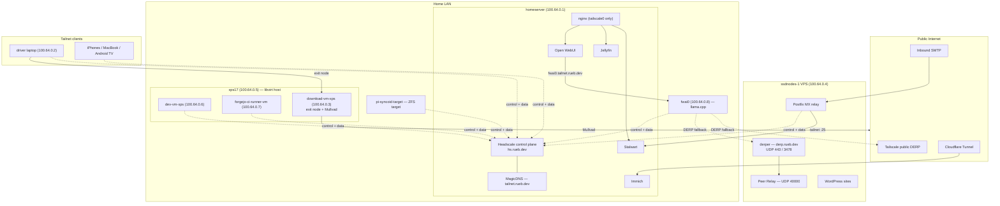
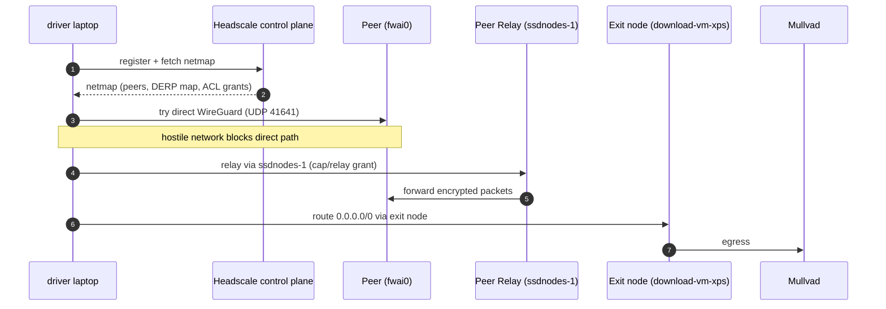

I ran my whole fleet on a hand-rolled WireGuard mesh for a long, long time. It
worked — I'm not complaining — but every new device meant another keypair,  and
another client config to hand-deliver, and access control was crafted on each
device's firewall.

After being on my backlog for far too long, this past week I finally got around
to swapping out Wireguard for
[Headscale](https://github.com/juanfont/headscale), a self-hosted control plane
for the standard Tailscale clients.

### How it fits together

Headscale is the control plane, and the devices still run the standard Tailscale client. That's the part I like: I only run the coordination server myself, and everything else is the normal, battle-tested Tailscale client.

TODO: generate the chart from this mermaid code and add it to this blog post


### Setting up the control plane

The control plane runs on my `homeserver` ([commit](https://github.com/ruebenramirez/systems/commit/feebb62)):

```nix
services.headscale = {
  enable = true;
  package = pkgs-unstable.headscale;
  address = "127.0.0.1";
  port = 8090;
  settings = {
    server_url = "https://hs.rueb.dev";
    dns = {
      magic_dns = true;
      base_domain = "tailnet.rueb.dev";
      override_local_dns = true;
      nameservers.global = [ "1.1.1.1" "1.0.0.1" ];
    };
  };
};
```

MagicDNS does feel like magic. Every node gets a `*.tailnet.rueb.dev` name, so I
can stop hand-maintaining DNS records and just let the control plane keep the
names in sync for me.

On the client side there's one shared module. Each machine decrypts a
pre-authorized key from my `sops-nix` flake input and connects on boot:

```nix
services.tailscale = {
  enable = true;
  package = pkgs-unstable.tailscale;
  authKeyFile = config.sops.secrets.tailscale-auth-key.path;
  extraUpFlags = [ "--login-server" "https://hs.rueb.dev" ];
};
```

Adding a machine is now just:
- import the module
- add a secret
- rebuild

### The migration

I joined every machine to the tailnet first
([commit](https://github.com/ruebenramirez/systems/commit/96fc855)), repointed
DNS, and then pulled WireGuard out
([commit](https://github.com/ruebenramirez/systems/commit/a760a4b)). That last
step was mostly just deleting one import line per machine. The daily driver's
network scripts now just stop and start `tailscale`
([commit](https://github.com/ruebenramirez/systems/commit/9be6f6a)), and
`nup-fleet` lost its `-lan` suffixes so every deploy rides the tailnet
([commit](https://github.com/ruebenramirez/systems/commit/5125981)).

I do still have some Android TVs running on Wireguard to access Jellyfin, so
I've left jellyfin accessible there until I'm able to migrate eacho of those
devices over to the new VPN.


TODO: change this to talk about locking down access to production services via Headscale Grants.
The rule I settled on: services listen on the tailnet interface or loopback,
never `0.0.0.0`. For nginx that meant a default listen address plus ordering it
after the interfaces come up
([commit](https://github.com/ruebenramirez/systems/commit/7162fb3)):

```nix
services.nginx.defaultListenAddresses = [ "100.64.0.1" ];

systemd.services.nginx = {
  wants = [ "tailscaled-autoconnect.service" "wg-quick-wg0.service" ];
  after = [ "tailscaled-autoconnect.service" "wg-quick-wg0.service" ];
};
```

Then I moved the services one at a time:

| Service | Change |
| --- | --- |
| Mail (Stalwart + Postfix) | WireGuard targets replaced with tailnet IPs; trusted proxy dropped |
| nginx | Defaults to tailscale; Jellyfin dual-bound to WireGuard + tailnet |
| Open WebUI | Points at `fwai0.tailnet.rueb.dev` |
| Forgejo runner | Rides the tailnet |
| llama.cpp | Reached over the tailnet |
| Immich | Cloudflare tunnel untouched |
| filebrowser | Deleted; Samba covers it now |

Mail was the delicate one. Inbound mail lands on `ssdnodes-1` and relays to Stalwart on `homeserver`, so I swapped the old `10.100.0.2` wireguard target for headscale `100.64.0.1`.  And locked down stalwart mail server and bulwark mail server to the tailscale interface.  I'm able to sufficiently lock down access via Headscale Grants.

### Two Things That Bit Me

My Android phone's Tailscale app kept crashing.  It turned out Headscale was
serving a duplicate node entry
([tailscale#21128](https://github.com/tailscale/tailscale/issues/21128), fixed
in [headscale#3459](https://github.com/juanfont/headscale/pull/3459)).  Pinning
Headscale to `pkgs-unstable` (and deploying v0.29.4) sorted it out
([commit](https://github.com/ruebenramirez/systems/commit/f56a9dc)).

Adding tailscale gui clients (iOS, macOS, Android, and Android TV devices) was
the other one gotcha.  Registering It just would not join with a pre-authorized
key. You install Tailscale, enter the alternative control plane, and finish the
QR code on your phone, which hands you a command to run on the server:

```
headscale nodes register --user <user> --key <nodekey>
```

I deliberately skipped OIDC SSO (overkill for a personal tailnet).  Not the
smoothest, but honestly way better than the FTP-server-and-sneakernet dance for
deploying the old WireGuard configs.

### Who can talk to what

Access control now lives on the control plane instead of every device's
firewall:

TODO: update this control plane configuration to represent the current
configuration (has grants for atv devices to reach jellyfin, users to reach
jellyfin and other Grant access controls)
```json
{
  "groups": {
    "group:admins": ["rueb@"],
    "group:home-users": ["moni@"],
    "group:jellyfin": ["jellyfin-devices@"]
  },
  "hosts": {
    "homeserver": "100.64.0.1/32",
    "ssdnodes-relay": "100.64.0.4/32"
  },
  "autoApprovers": { "exitNode": ["tag:exit"] },
  "grants": [
    { "src": ["group:home-users"], "dst": ["homeserver"],
      "ip": ["443", "3001", "445", "25,465,587,993,4190"] },
    { "src": ["group:admins", "group:home-users"],
      "dst": ["ssdnodes-relay"], "app": { "tailscale.com/cap/relay": [] } }
  ]
}
```

TODO: update the plain english description to match the updated mermaid chart
Home users reach the homeserver on exactly the ports they need, both groups can use the VPS as a relay, and admins can do anything. Exit nodes use the same file: `download-vm-xps` already runs Mullvad, so I advertise it and let `autoApprovers` handle the approval. Any client can route through it with a single command.


### Accessing the tailnet

DERP is Tailscale's relay for networks that block WireGuard's UDP. My clients use Tailscale's public DERP servers by default, which is fine since the traffic is already WireGuard-encrypted — but I wanted one of my own. I stood up a `derper` on the VPS, told Headscale about it with a custom map, and added a Peer Relay on UDP 40000 so nodes can relay through it directly:

TODO: generate the chart from this mermaid code and add it to this blog post


TODO: clean up this language
- Test DERP and Peer Relay from very locked down networks.  I haven't tested
this from a truly hostile network yet. The plan is to take the laptop to the
library.


### Yay it's working

I put this off for months because it seemed like mess that would rob me of a
weekend. It was an afternoon of cutover work and a week of tidying up the loose
ends.

The clients are battle-tested, the control plane is mine, and access
control is finally declarative.

